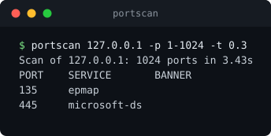

# portscan


A multithreaded TCP connect scanner with banner grabbing, written with the standard library only.

> Use only on systems you own or have written permission to test.



## Features

- Port specs: single ports, lists, ranges and a `top` preset of commonly exposed services
- Thread pool with configurable size and connect timeout
- Banner grabbing, with an HTTP probe for web ports that wait for the client
- Service names resolved from the local services database
- Table or JSON output for scripting

## Install

```bash
git clone https://github.com/Ernest-Kosmatko/portscan.git
cd portscan
pip install -e .
```

## Usage

```bash
portscan 192.168.1.10                  # top ports
portscan example.test -p 1-1024 -t 0.5
portscan 10.0.0.5 -p 22,80,443 -o json
```

Example output:

```
Scan of 127.0.0.1: 1024 ports in 3.42s
PORT    SERVICE       BANNER
135     epmap
445     microsoft-ds
```

## How it works

Each port is tested with a full TCP handshake (`socket.create_connection`). A completed handshake means the port is open; a refusal or timeout means closed or filtered. Work is spread over a `ThreadPoolExecutor`, so total time is roughly `ports / threads * timeout` in the worst case.

A connect scan is noisy and shows up in target logs. It does not need elevated privileges, unlike SYN scanning.

## Tests

```bash
pip install -e .[dev]
pytest
```

Tests start local listening sockets, so no external network access is needed.

## Limitations

- IPv4 only, one host per run
- No UDP scanning and no OS or service fingerprinting
- Banner parsing keeps only the first line

## License

MIT
